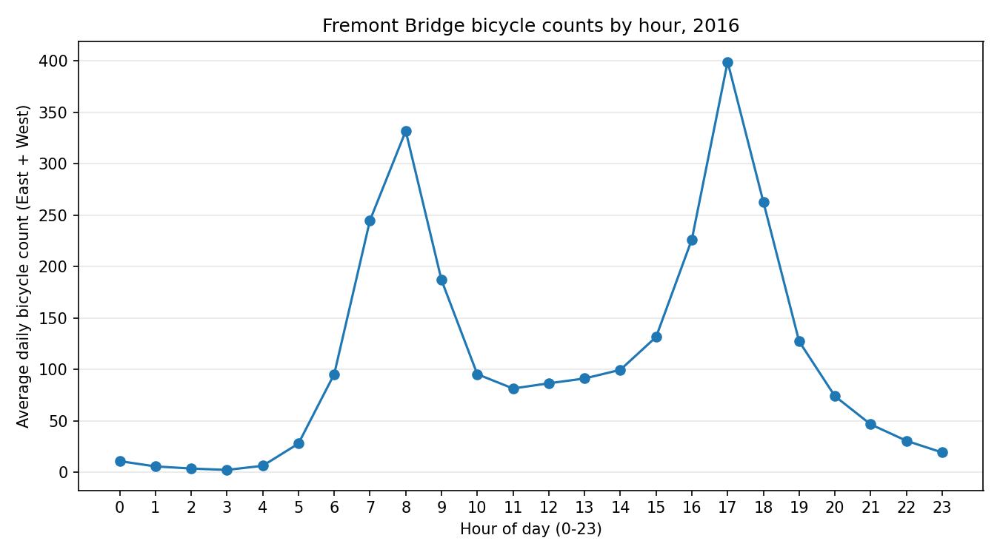

# HW1: Fremont Bridge bicycle counts

This assignment looks at how bicycle traffic changes over the day using the
[Fremont Bridge counter data](https://data.seattle.gov/Transportation/Fremont-Bridge-Hourly-Bicycle-Counts-by-Month-Octo/65db-xm6k).
The analysis uses the records from **2016**.

## Process

The script reads the CSV with `pd.read_csv`, removes identical duplicate
rows, converts `Date` to a datetime,
and changes the sidewalk counts to nullable integers. Counts are whole
numbers, but missing observations need to stay missing. It adds East and
West to get `Total`, then uses `.dt.hour` and `.dt.year` to add the hour and
year columns.

After selecting 2016, the script checks for missing sidewalk counts and
timestamps that are absent from the file. Incomplete rows are left out of
the analysis. Filling them with zero would incorrectly suggest that no
bicycles crossed during those hours. This avoids treating missing readings
as measurements, although missing observations can still affect how
representative the averages are.

The remaining records are grouped by hour. Each plotted value is the mean
East + West count for that hour across the days with complete readings.
For example, the point at 8 describes the average count from 8 to 9 a.m.
Using `idxmax()` on these averages gives the busiest hour without estimating
it from the graph. The plot is saved as `counts_by_hour.png` in this folder.

## Running the analysis

From the `hw1` directory, with Python 3.13 or newer:

```bash
python3.13 -m venv .venv
source .venv/bin/activate
python -m pip install -e .
curl -L --fail 'https://data.seattle.gov/api/views/65db-xm6k/rows.csv' \
    -o src/hw1_data_analysis/bicycle_data.csv
python src/hw1_data_analysis/hw1.py
```

The CSV goes next to `hw1.py`, following the assignment's folder diagram.
`.gitignore` excludes it from GitHub, along with the local Python environment.

## Results and verification

The direct Seattle download was unavailable in the execution environment,
so this run used the [copy published with the Python Data Science Handbook](https://github.com/jakevdp/bicycle-data/blob/dd8178d4776730fc6a6bfd33f3fa17ebadd5281b/FremontBridge.csv).
That export covers October 2012 through December 2021, including all of 2016.
The download command above points to the original Seattle source; results
here are from the archived copy rather than a fresh Seattle export.

The archive contains each 2016 row twice. Removing identical duplicates
leaves **8,784 hourly records**, as expected for a leap year. There is
**1 hour with missing counts**, March 13 at 2 a.m. No hourly timestamps
are absent. After excluding that incomplete row, 8,783 records remain.
The busiest hour is **17:00-18:00 (5-6 p.m.)**, averaging **399.03 bicycles**.



The script was run on the archived data. A small separate test dataset also
checked year filtering, missing counts, hourly averages, and plot creation.
The available environment used Python 3.11.7, pandas 2.1.4, NumPy 1.26.4,
and matplotlib 3.10.8. The assignment's requested versions are kept in
`pyproject.toml`; installation and execution with those versions still need
to be checked in an environment with package download access.

## Date formats

- Python's [`datetime.datetime`](https://docs.python.org/3/library/datetime.html)
  represents a single date and time, with optional timezone information.
- NumPy's [`datetime64`](https://numpy.org/doc/stable/reference/arrays.datetime.html)
  is suited to arrays of dates. It has a chosen time unit, such as seconds
  or nanoseconds, and does not store timezone information.
- Pandas' [`to_datetime`](https://pandas.pydata.org/docs/reference/api/pandas.to_datetime.html)
  converts the whole column to a datetime dtype. Individual values are
  `Timestamp` objects, and `.dt` provides operations on the whole column.

The script keeps the source's local clock hours. In an ISO date such as
`2016-01-01T08`, the `T` separates the date and time; it is not a tab.
